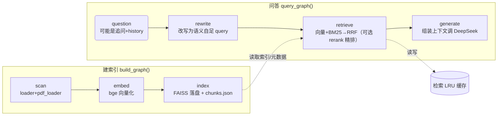

# KBRAG — 个人知识库 RAG 系统

> **一句话定位**：从零实现的、端到端可量化的中文知识库问答系统。覆盖"多格式解析 → 结构化分块 → 混合检索 → 交叉编码重排 → 多轮对话改写 → 检索评测回归"全链路，每个环节的收益都有对照数据。
>
> 栈：Python 3.11 · LangGraph · FAISS · bm25s · jieba · bge（sentence-transformers）· DeepSeek API · PyMuPDF

---

## 1. 能力对照（按"增量"开发，逐轮都有基准）

| 能力 | 模块 | 关键决策 / 可量化的收益 |
|---|---|---|
| 多格式解析 + 引用溯源 | `loader.py` `pdf_loader.py` | md 目录 + PDF（PyMuPDF）双源；返回带 `source_file / title / section_path`，可定位到具体章节 |
| 结构化分块 | `loader.py` | 按 **章节 > 问题** 两级切分，块 500–1500 字，支持二级 `##` 再切 |
| 混合检索（向量 + BM25 → RRF） | `retriever.py` `bm25_indexer.py` | 中文先 jieba 切词再喂 bm25s（绕过默认英文分词）；只看名次的 RRF(k=60) 规避两路量纲冲突。**块命中@5 55%→60%，文档命中@5 65%→85%** |
| 交叉编码器重排 | `reranker.py` | bge-reranker-v2-m3，大池召回→精排 top5。**中文块命中@5 60%→90%，MRR@5 0.492→0.875** |
| 多轮对话改写 | `rewriter.py` `graph.py` | LangGraph `rewrite` 节点把 [近 2 轮历史, 追问] 改写成语义自足 query（代词/省略还原）；命中 60%→80% |
| Multi-Query 多样化检索 | `rewriter.rewrite_multi` `retriever.retrieve_multi` | 1 主改写句 + 2 精准关键词组；深池召回(MQ_POOL=20)+（出现次数·RRF 名次分）融合。**命中 80% / MRR 0.667** |
| 评测回归 | `eval/` `cache.py` | `hit@k / MRR@5` 双口径；约 50 题中文回归集 + 5 题多轮复审集；检索级 LRU 缓存复用 |

## 2. 架构

LangGraph 编排两条独立链路，节点内算法由各模块负责，无业务散落在编排层。



**数据流要点**：`scan` 把 Agent 教科书（md）+ 墨圆面试 PDF 统一切块编号 → `embed` 向量化 → `index` 落盘 FAISS（索引放 ASCII 缓存目录，规避中文路径写盘问题）。问答时 `rewrite`(仅多轮有历史时触发) → `retrieve`(混合召回+可选精排，命中缓存直接复用) → `generate`(带溯源上下文的 LLM 回答)。

## 3. 量化结果（可直接写进简历的数字）

> 口径：`hit@k` = 正确块/文档是否进 top-k；`MRR@5` = 正确块首次出现位置的倒数均值。LLM 改写出自 DeepSeek，percent 随采样浮动，横向对比以同轮对照为准。

| 增量 | 改动 | 指标变化 |
|---|---|---|
| 3 · 混合检索 | 纯向量 → 向量+BM25 RRF | 块命中@5 55→60%；**文档命中@5 65→85%** |
| 4 · 重排 | 召回池 → bge-reranker 精排 | 中文 块命中@5 60→**90%**，MRR@5 0.492→**0.875** |
| 7 · 多轮改写 | 追问 + rewrite | 命中 60→80% |
| 7 · Multi-Query | 单改写 → 多样化+融合 | 命中 **80%** / MRR **0.667**（压过同轮 baseline 与单改写） |

## 4. 快速开始

```bash
# 1) 配置 API（DeepSeek 兼容 OpenAI 接口）
#    复制 .env.example → .env，填 OPENAI_API_KEY / OPENAI_BASE_URL / OPENAI_MODEL

# 2) 建索引（默认扫 Agent 教科书；--kb 指定其他目录）
python main.py build --kb <知识库目录>

# 3) 单轮问答
python main.py query "ReAct 的核心思想是什么？"

# 4) 交互式多轮对话（自动改写追问）
python main.py chat --verbose

# 5) 评测回归（检索层）
python eval/run_eval.py                          # 约 50 题回归集（增量3/4 口径）
python eval/run_eval_multi.py                    # 5 题多轮追问：不改写 vs 改写 vs Multi-Query
```

## 5. 文件地图

| 文件 | 职责 |
|---|---|
| `config.py` | 路径 / 分块 / 检索 / 重排参数；`KBRAG_USE_RERANK` 环境开关 |
| `loader.py` `pdf_loader.py` | md 目录与 PDF 解析 + 结构化切块 |
| `embedder.py` | bge 中文向量化（query / batch） |
| `indexer.py` `bm25_indexer.py` | FAISS 向量索引 + jieba/bm25s 稀疏索引（惰性构建+缓存） |
| `retriever.py` | 混合检索 RRF → 可选重排；`retrieve_multi` 深池融合 |
| `reranker.py` | Cross-Encoder 精排（进程内单例） |
| `rewriter.py` | 多轮改写 `rewrite` / Multi-Query `rewrite_multi` |
| `generator.py` | 组装带溯源上下文，调 LLM 生成回答 |
| `graph.py` | LangGraph 两条链路编排与状态 |
| `cache.py` | 检索级 LRU 缓存，多轮会话复用 |
| `main.py` | CLI：`build` / `query` / `chat` |
| `eval/` | 评测集、评测/回归/多轮对比脚本、英文库评测 |

## 6. 已深挖的工程细节（面试谈资）

- **中文分词桥接**：`bm25s` 默认英文正则词边界对中文无效，必须在喂入前用 jieba 切词成 `List[List[str]]`。
- **RRF 规避量纲冲突**：向量分 0~1、BM25 可到几十，不能直接相加，故选只看名次的 `Σ 1/(k+rank)`。
- **两段式精排**：Cross-Encoder 只能在线逐候选打分，故"大池召回 → 精排 top5"。中文库收益巨大，英文库因纯向量已足够准而收益小——印证"重排的价值在不完美的初检之上"。
- **Multi-Query 融合缺陷（发现→修复）**：旧版"每 query 截 top5 + 纯出现次数投票"会把"仅专精关键词命中、且排 #1"的正确块挤出（复现确证块 162 掉出 top5）。修复为深池召回 +（出现次数·RRF 名次分）仲裁 + 并集统一精排 1 次，块 162 拉回 top3。
- **Windows 中文路径坑**：FAISS C++ 层无法写含中文路径，索引落到纯 ASCII 缓存目录。
- **检索缓存**：多轮会话内同 query 不重复命中文档，降低延迟与成本。

## 7. 已知边界（诚实标注）

- Multi-Query（`retrieve_multi`）已在检索层用评测集验证；CLI `query/chat` 默认走**单 query 改写**（`retriever.retrieve`），如需启用需在 `graph.py` 换成 `rewrite_multi + retrieve_multi`。
- 语料规模小（约 300 块 / 一册教科书 + 一份面试 PDF）；大数据量下的分片、Milvus、批量向量化属规划项。
- 生成器目前直接调 DeepSeek API，未做答案与引用块的自动一致性校验。

---
*学习与教学背景文档见上级目录 `01_项目拆解.md` / `02_增量需求与交付路线.md` / `对照记录_增量*`。*